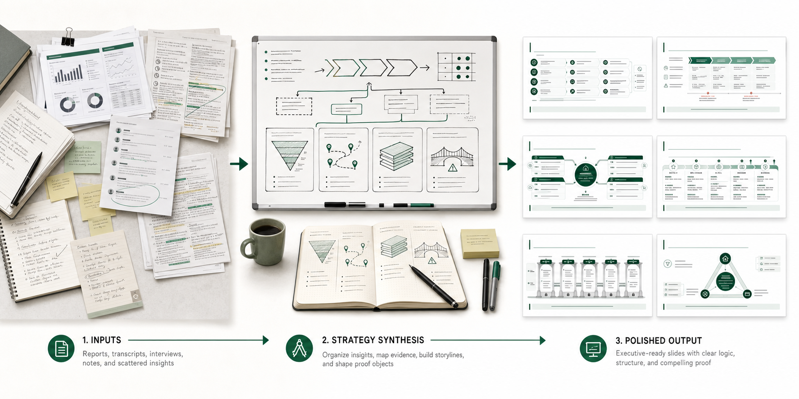
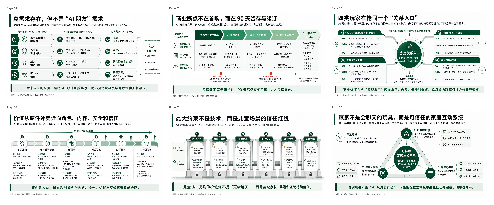
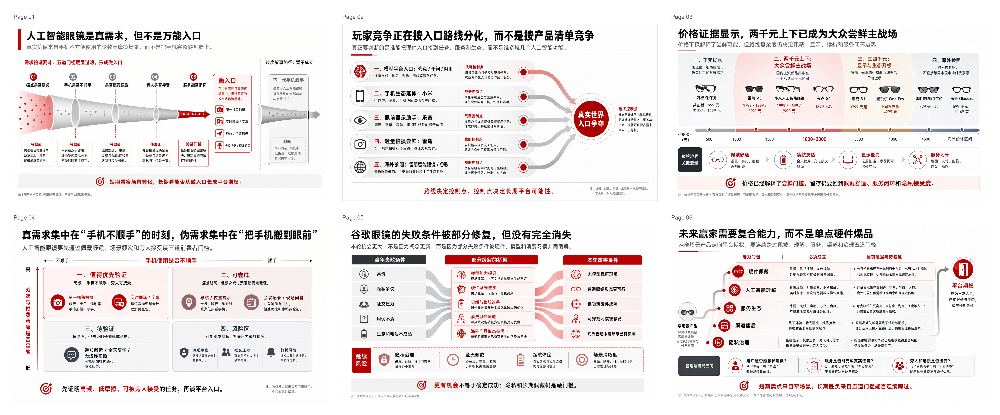
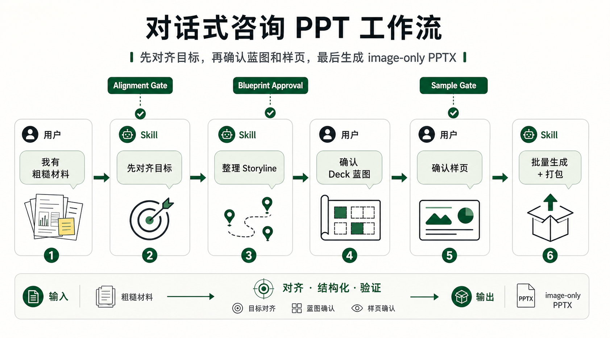

# RW Consulting PPT Skills（Claude Code 移植版）

把粗糙的业务材料变成 **proof-object-first** 的图片版咨询 PPT；把图片页恢复成可编辑 PPTX。

本仓库是 [Pikapika260214/rw-consulting-ppt](https://github.com/Pikapika260214/rw-consulting-ppt)（Codex Skills 原版）的 **Claude Code 移植版**，方法论与原版一致，渲染后端按 Claude Code 能力重写。

两个互相独立的 Claude Code Skills：

- `rw-consulting-ppt`：把行业报告、会议纪要、访谈笔记和半成品 bullet，转成 `proof-object-first` 的图片版咨询 PPT。
- `astralow-for-editable-ppt`：把单张 slide 图片、PNG、截图，或图片型 PPT 的页面，转换成更可编辑的 PowerPoint。

两者平级放在 `claude-skills/` 目录下。`rw-consulting-ppt` 默认交付 PNG + `image-only PPTX`；需要后续编辑时用 `astralow-for-editable-ppt` 逐页转换；多页结果另行合并并检查。

## 与 Codex 原版的区别

| 环节 | Codex 原版 | 本移植版 |
|---|---|---|
| 全页图片生成 | Image2 直接生成 | 模型编写 1920×1080 HTML（内联 SVG proof object）→ `render_slide.py`（Playwright + 系统 Chrome）截图 |
| 驱动模型 | Astra low（Codex） | 不绑定模型（当前会话模型即可，如 DeepSeek） |
| PPTX 渲染预览 | Windows PowerPoint COM | LibreOffice headless；最终验收用 WPS 人工确认 |
| 编辑验证 | PowerShell + PowerPoint COM | `verify_edit.py` python-pptx 回路验证 |
| 照片级配图 | 无 | 可选：`gen_image.py` 调豆包 Seedream（OpenAI 兼容，默认无水印） |
| 打包 PPTX | `package_image_deck.py` | 原样复用（纯 Python，无平台依赖） |

方法论层（alignment-first、storyline-before-design、proof-object-first、三道批准门禁、样页 gate、视觉治理锁）**原样保留**。



> From rough business inputs to proof-object-first consulting slides.

## 效果展示

下面是两个 6 页 deck 的高清 3×2 overview（原版 Image2 生成的样张，仅作风格参照）。点击图片可以打开原图查看细节。

### 示例 1：AI 陪伴玩具行业判断

<p>
  <a href="claude-skills/rw-consulting-ppt/examples/ai-companion-toys-management-deck/overview-3x2.png"></a>
</p>

### 示例 2：AI 眼镜行业研究

<p>
  <a href="claude-skills/rw-consulting-ppt/examples/ai-glasses-market-deck/overview-3x2.png"></a>
</p>

## 它解决什么问题？

很多 PPT 难做，不是因为不会排版，而是因为输入材料本身还很粗糙：

- 多份行业报告读完了，但还没有 synthesis。
- 会议纪要很长，但没有变成一组清晰的汇报页。
- 研究判断有了，但不知道每页应该证明什么。
- 大纲里全是 bullet，但缺少管理层能读懂的 `storyline` 和证据结构。

RW Consulting PPT Skill 的重点不是"美化 PPT"，而是把粗糙材料先变成可交付的咨询表达：

```text
粗糙材料 -> 目标对齐 -> storyline -> 页面 brief -> 样页确认 -> PNG / image-only PPTX -> 可选关键页 editable conversion
```

## 30 秒开始

把 `claude-skills/` 下的两个 skill 目录放到你的 Claude Code skills 目录里（复制或软链二选一）：

```bash
# macOS / Linux：软链（推荐，仓库更新即时生效）
mkdir -p ~/.claude/skills
ln -sfn "$PWD/claude-skills/rw-consulting-ppt" ~/.claude/skills/rw-consulting-ppt
ln -sfn "$PWD/claude-skills/astralow-for-editable-ppt" ~/.claude/skills/astralow-for-editable-ppt

# 或复制
cp -R ./claude-skills/rw-consulting-ppt/. ~/.claude/skills/rw-consulting-ppt/
cp -R ./claude-skills/astralow-for-editable-ppt/. ~/.claude/skills/astralow-for-editable-ppt/
```

Windows PowerShell 用户把目标目录换成 `$env:USERPROFILE\.claude\skills\`。

## 运行依赖

```sh
python -m pip install -r requirements.txt   # python-pptx、Pillow、playwright、certifi
```

- **Python 3.10+**；渲染走**系统 Google Chrome**，无需下载 Chromium。
- **LibreOffice**（可选）：`brew install --cask libreoffice`，用于 astralow 的自动渲染预览；没装则跳过预览，手动用 WPS 验收。
- 实际 Office 渲染与编辑验证需要 Windows 桌面 PowerPoint；macOS 用 LibreOffice 预览 + **WPS 人工验收**，交付说明中标注"未经 Office 验证"。
- 模型不绑定：Claude Code 当前会话模型即可（如 DeepSeek），skill 不会自动切换模型。

## 照片级配图（可选）

页面图表由内联 SVG 绘制，无需任何配置。只有需要**照片级写实配图**时才用 `gen_image.py`，默认走豆包 Seedream（火山方舟 Ark）：

```sh
export IMAGE_API_KEY="<火山方舟 API Key>"   # endpoint 与模型 ID 已内置
```

其他 OpenAI 兼容服务商：`IMAGE_API_BASE` + `IMAGE_API_MODEL` 覆盖即可。

**水印约定（对所有使用者强制）**：所有 AI 配图必须无水印——脚本默认请求 `watermark: false`；若服务商强制水印，裁掉水印角或换图，禁止直接使用带水印的图，并在交付说明中标注处理方式。

## 触发方式

生成图片版咨询 deck：

```text
请使用 /rw-consulting-ppt，把这些行业研究材料整理成 6 页中文管理层汇报。

目标受众：业务负责人
交付模式：独立阅读型报告页
信息密度：标准咨询密度
视觉风格：管理层报告风，白底，深绿作为强调色
输出格式：PNG + image-only PPTX
```

转换单页图片为可编辑 PPTX：

```text
使用 /astralow-for-editable-ppt 将这张图转成可编辑 PPT。
保留原文、布局和视觉关系，输出 PPTX 与实际渲染预览，说明哪些局部仍是图片。
```

## 适合什么场景？

### 1. 行业报告分析 PPT

多份行业报告、访谈纪要、公开资料和研究笔记 → synthesis → 管理层可读的行业判断页。它会拆出：核心问题、working thesis、storyline、页面级 claim、proof object、evidence boundary。

### 2. 会议 recap PPT

长纪要 / 逐字稿 → recap deck：核心议题、已形成共识、仍有分歧的问题、下次讨论前需要补齐的证据、面向管理层或客户的简洁 recap 页。

## 它不是普通 PPT 模板

- 每页 = 一张完整 16:9 图片（HTML 全页设计 → 截图 → PNG）。
- 每页用 `proof object` 承载论证（漏斗、路径图、玩家格局、能力栈、风险桥……），而不是堆 bullet。
- 先出 1-2 页样页确认风格、密度和表达逻辑，通过后再批量。
- 需要 PPTX 时机械打包成 `image-only PPTX`；关键页可再用 astralow 逐页转可编辑。

它不会做：

- 从粗糙材料一步生成整套全页、全对象原生可编辑 PPTX；
- Python / Pillow / SVG 文件绘制的伪 PPT；
- 普通模板套壳或三栏卡片堆叠；
- 把裸 HTML 线框当成品交付（HTML 必须承载咨询 exhibit 的完整视觉系统）。

## 工作流



1. **Preference alignment**：先确认受众/场景、交付模式、页数、信息密度、视觉风格/主题色、输出格式。
2. **Inputs for PPT Production**：把粗糙材料整理成生产输入包（Context、Core Question、Working Thesis、Storyline、Page-Level Inputs、Open Questions）。
3. **Deck Blueprint**：每页标题、governing message、proof object、visual mode、待补证据。没有 blueprint approval，不进入样页。
4. **Sample brief**：为 1-2 页代表性页面写详细 brief。
5. **Sample gate**：先渲染样页，通过后再批量；样页像普通模板/信息太空/结论太多就改 brief，不直接批量。
6. **Batch generation and packaging**：批量渲染剩余页面，用 `scripts/package_image_deck.py` 打包 `image-only PPTX`。
7. **Selective editable conversion**：关键页交给 astralow 逐页转可编辑，多页另行合并并检查。

## 输出物

```text
slides/
  slide_01.png
  slide_02.png
  ...
contact_sheet.png
deck-name-image-only.pptx
run_notes.md
```

`deck-name-image-only.pptx` 每页只有一张完整图片，不含可编辑文本对象。启用关键页可编辑化后，每页另交付 editable PPTX、渲染预览和简短报告，实际可编辑范围以最终文件及局部图片说明为准。

## 质量护栏

- **Alignment-first**：没确认目标、页数、密度、风格和输出格式，不开始生产。
- **Storyline before design**：先确认核心问题、working thesis 和页面逻辑，再写 slide brief。
- **One slide, one claim**：每页只有一个最高优先级结论。
- **Proof-object-first**：每页必须有一个能承载论证的视觉结构。
- **Density preservation**：独立阅读型报告页不能为了"干净"变成空海报。
- **Sample rejection**：样页不合格就拒绝重写，不批量。
- **配图无水印**：所有 AI 生成配图必须请求无水印输出，生成后目检四角。

## 适合 / 不适合

适合：行业分析、市场判断、玩家格局、机会评估；会议 recap；从粗糙材料提炼 storyline 的 PPT；先看样页再批量的工作流。

不适合：需要整套 deck 全页、全对象原生可编辑且不接受图片页；大量数据表格的精确排版；企业模板规范非常严格的内部汇报；只要一张视觉海报；已有完整 PPT 只想换皮美化。

## 目录结构

```text
claude-skills/
  README.md                     # 移植说明与验证记录
  rw-consulting-ppt/
    SKILL.md
    assets/                     # 展示图、联系二维码
    examples/                   # 两个 6 页示例 deck（原版样张）
    references/                 # 9 个方法论文档（视觉治理、proof object 等）
    scripts/
      render_slide.py           # HTML -> 16:9 PNG（Playwright + 系统 Chrome）
      package_image_deck.py     # PNG -> image-only PPTX
      gen_image.py              # 豆包 Seedream 配图（默认无水印）
  astralow-for-editable-ppt/
    SKILL.md
    references/                 # 工具接口、质量检查
    scripts/
      editable_ppt.py           # Deck API（源图坐标 -> 可编辑对象）
      verify_edit.py            # 编辑回路验证
    requirements.txt
```

## FAQ

**为什么默认不是 editable PPTX？** `rw-consulting-ppt` 先生成完整咨询页图像，默认 PPTX 每页是一张图片；需要编辑时用 `astralow-for-editable-ppt` 转换选中页面。

**生成的 PPTX 还能修改吗？** 图片版 PPTX 可整体移动或替换页面图片；转换后原生文本框、形状可编辑，局部裁图内部不可逐对象编辑。

**为什么一定要先确认样页？** 批量跑偏的返工成本高，sample gate 先验证风格、密度、可读性和 proof object。

**可以只生成 PNG 吗？** 可以。关键页 editable conversion 是额外步骤，只在需要时做。

**可以用于英文 deck 吗？** 可以，默认示例和质量规则以中文管理层报告页为主，英文 deck 保留相同原则。

**"渲染验证"可信吗？** astralow 的预览由 LibreOffice headless 渲染，是排版参考，**不等于 Office 验证**；最终验收请用 WPS/PowerPoint 人工打开确认。

## 交流与联系作者

欢迎扫码加入原作者的微信群，讨论 AI x Consulting 工作流与使用问题。二维码过期后可通过 GitHub issue 提醒更新。

<p>
  
</p>

企业级 PPT 视觉设计、AI 战略咨询等合作需求，可通过小红书联系作者。

<p>
  
</p>
